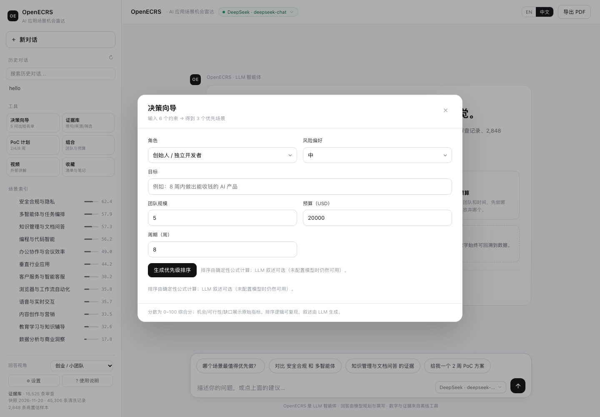
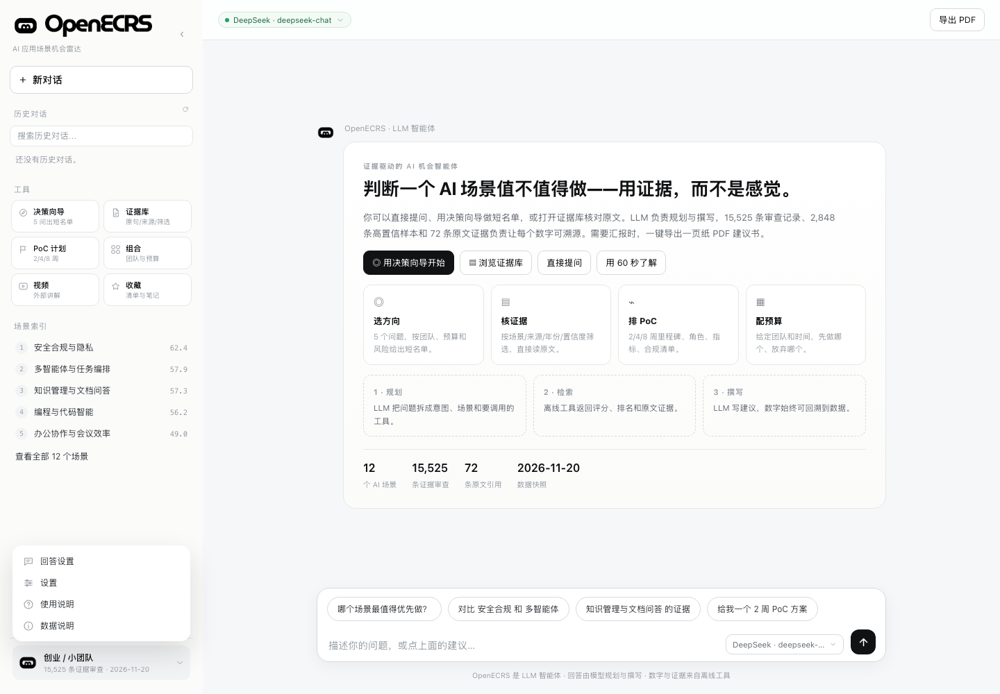

<p align="center">
  
</p>

<p align="center"><b>Open Evidence-Centric Recommendation System</b><br>
An LLM-required agent that turns public AI-tooling signals into auditable, prioritised product opportunities.</p>

<p align="center">
  
  
  
  
</p>

<details>
<summary><b>Table of contents</b></summary>

- [What is OpenECRS?](#what-is-openecrs)
- [Highlights](#highlights)
- [Screenshots](#screenshots)
- [What you can do](#what-you-can-do)
- [Architecture](#architecture)
- [Quick start](#quick-start)
- [Languages and roles](#languages-and-roles)
- [HTTP API](#http-api)
- [Evidence base and methodology](#evidence-base-and-methodology)
- [Repository layout](#repository-layout)
- [Tests](#tests)
- [Security and privacy](#security-and-privacy)
- [FAQ](#faq)
- [License and attribution](#license-and-attribution)

</details>

<p align="center">
  <a href="README.zh-CN.md">中文版</a> ·
  <a href="docs/screenshots/hero-en.png">Screenshot</a> ·
  <a href="skills/openecrs_agent.md">Agent Skill</a> ·
  <a href="#quick-start">Quick start</a> ·
  <a href="#http-api">API</a>
</p>

---

## What is OpenECRS?

Most “AI opportunity” lists are opinion pieces. OpenECRS is a working agent system that answers a narrower, more useful question:

> **Which AI application scenario is worth building, why, and what should we do next?**

It combines three layers:

1. **An evidence base** built from 52,007 public AI-tooling records (Hacker News, GitHub, arXiv, Stack Overflow, Product Hunt), cleaned into 45,306 records, 15,525 demand units, 2,848 high-confidence scenario samples and 72 quoted evidence spans.
2. **Deterministic tools** that compute scenario scores, rankings, comparisons, evidence search, PoC plans, budget portfolios and scenario trends.
3. **An LLM agent** that plans the answer, calls those tools, and writes a one-sentence recommendation, supporting explanation, an action plan and a risk list — in English, 中文, 日本語 or Español.

The LLM is **mandatory**. Without a configured model the agent refuses to chat; numbers, rankings and quotes always come from the tools, never from the model.

---

## Highlights

- **LLM required, no template fallback** — hosted OpenAI-compatible API or a local Qwen2.5-3B + LoRA adapter.
- **Real agent loop** — `plan → tools → answer`, two model calls per turn, with an inspectable Agent trace.
- **Grounded by construction** — 12 scenarios, 72 quoted spans, explicit source, year and confidence on every evidence card.
- **Six working tools** — Decision Wizard, Evidence Explorer, PoC Planner, Portfolio Allocator, Scenario Deep-dive, Saved Workspace — plus external video search.
- **One-page PDF brief** — advice, scorecard, evidence excerpts, action plan, risks and data limitations.
- **Multilingual & role-aware** — follows the system language, supports English / 中文 / 日本語 / Español, and answers from founder / enterprise / investor / PM perspectives.
- **Persistent conversations** — history survives reloads and server restarts; search, rename and delete from the sidebar.
- **Clean, collapsible UI** — official OpenECRS logo, responsive sidebar, model switcher, settings split into Model and Preferences.
- **Runs offline by default** — no build step, no CDN, no telemetry; only the configured LLM endpoint receives requests.

### Design principles

- **Grounded by default** — if a number cannot be traced to a tool result, it does not belong in the answer.
- **LLM for language, code for truth** — the model plans and writes; deterministic code owns scores, rankings and quotes.
- **Uncertainty is a feature** — every brief states calibration, sample and source-bias limits.
- **Local-first** — one Python process, no build step, no telemetry, no CDN.

---

## Screenshots

| First-run workspace | Scenario deep-dive |
|---|---|
|  |  |

| Decision wizard | Sidebar & profile menu |
|---|---|
|  |  |

More screenshots: [`docs/screenshots/`](docs/screenshots/) · sample PDFs: [`docs/examples/`](docs/examples/).

---

## What you can do

| Capability | What it returns |
|---|---|
| **Decision Wizard** | 6 constraints (role, goal, team size, budget, horizon, risk) → a 3-scenario shortlist with deterministic scores, fit reasons and watch-outs; LLM adds a narrative. |
| **Evidence Explorer** | Filter the 72 quoted spans by scenario, source, year, confidence and positive/negative evidence; read the original span and open the source. |
| **PoC Planner** | 2 / 4 / 8-week milestones with deliverables, exit criteria, roles, success metrics, data/compliance checklist and heuristic effort/cost. |
| **Portfolio Allocator** | Given a team, timeline and budget: what to validate, what to build, what to drop. |
| **Scenario Deep-dive** | Opportunity scorecard, yearly trend, source mix, supply signals (repos/stars/papers/Show HN), evidence excerpts. |
| **Saved Workspace** | Pin scenarios, add notes, and ask the agent to compare the saved shortlist. |
| **Video search** | External YouTube/Bilibili search links per scenario (clearly labelled as external, not evidence). |
| **Chat** | Natural-language questions: ranking, scenario analysis, comparison, evidence requests, PoC planning, video requests, greetings. |
| **PDF brief** | One-page A4 brief with advice, scorecard, evidence, actions, risks and scope. |

All estimates are labelled **heuristic**; the agent never presents them as market facts.

---

## Architecture

```text
┌─────────────────────────────┐
│  User question / UI action  │
└──────────────┬──────────────┘
               │  role · language
┌──────────────▼──────────────┐
│  Planner (LLM call #1)      │  strict JSON: intent, scenarios, tools
└──────────────┬──────────────┘
               │
┌──────────────▼──────────────┐
│  Deterministic tool layer   │  catalog · ranking · scenario · compare
│                             │  evidence · search · videos
└──────────────┬──────────────┘
               │  grounded JSON
┌──────────────▼──────────────┐
│  Responder (LLM call #2)    │  advice · reply · actions · risks
└──────────────┬──────────────┘
               │
┌──────────────▼──────────────┐
│  Runtime assembly           │  metrics · ranking · evidence · trace
│                             │  chat card · PDF · history
└─────────────────────────────┘
```

The runtime owns data fidelity. The LLM only plans and writes; it never invents numbers, scenarios, sources or links.

---

## Quick start

```bash
# Python 3.11+ (verified on 3.14 / macOS)
pip install -r requirements.txt          # pandas is only needed to rebuild data.json

python code/agent_app.py --open          # -> http://127.0.0.1:8765
```

macOS users can double-click **`openecrs.command`**.

On first launch, open **Settings** and choose one of the two backends below. The UI, answers and PDFs switch language from **Settings → Preferences**.

### Option A — OpenAI-compatible API (recommended)

| Provider | Base URL | Model example |
|---|---|---|
| DeepSeek | `https://api.deepseek.com/v1` | `deepseek-chat` |
| OpenAI | `https://api.openai.com/v1` | `gpt-4o-mini` |
| Moonshot | `https://api.moonshot.cn/v1` | `moonshot-v1-8k` |
| DashScope compatible mode | `https://dashscope.aliyuncs.com/compatible-mode/v1` | `qwen-plus` |
| Local Ollama | `http://127.0.0.1:11434/v1` | any local model name |

Paste the key → **Test connection** → **Save**. Keys live only in `outputs/agent_ui/settings.json` (mode `0600`) and are sent only to the endpoint you configure. Environment variables `DEEPSEEK_API_KEY`, `OPENAI_API_KEY`, `LLM_API_KEY`, `LLM_BASE_URL`, `LLM_MODEL` are also supported.

### Option B — Local fine-tuned model

```bash
pip install -r requirements-lora.txt
# put Qwen2.5-3B-Instruct weights into models/Qwen2.5-3B-Instruct
# the pilot adapter ships in outputs/lora/adapter_pilot (desktop build only)
```

In Settings → Model → **Local fine-tuned**, set the base-model and adapter paths, test, save. CPU inference works but is slow; a GPU is recommended. The shipped pilot adapter was trained on 160 pseudo-labelled samples for 24 steps — it validates the training/inference chain, not accuracy.

### Multiple model profiles & one-click switching

The top bar and the composer both expose a model switcher. Each profile stores its own backend, key/paths and display name; switching applies to the next answer. Profiles can be added, edited or deleted from the same menu.

---

## Languages and roles

- **Languages:** System (default), English, 中文, 日本語, Español. “System” reads `navigator.language` (zh/ja/es, otherwise English). The choice is remembered locally and sent with every request.
- **Roles:** Founder, Enterprise, Investor, PM. The role changes planning priorities and tone (feasibility/MVP vs. compliance/scale vs. market/competition vs. roadmap/metrics), not the underlying numbers.
- Both live under **Settings → Preferences**; the bottom profile menu has a direct **Answer settings** shortcut.

---

## HTTP API

```bash
curl -s http://127.0.0.1:8765/api/chat \
  -H 'Content-Type: application/json' \
  -d '{"session":"demo","message":"Which scenario should we prioritise?","lang":"en","role":"founder"}'

curl -s -X POST http://127.0.0.1:8765/api/pdf \
  -H 'Content-Type: application/json' \
  -d '{"session":"demo","lang":"en"}' -o OpenECRS_brief.pdf
```

| Endpoint | Method | Description |
|---|---|---|
| `/api/chat` | POST | `{session, message, lang, role}` → answer with advice, reply, metrics, ranking, comparison, evidence, videos, actions, risks, engine, trace |
| `/api/pdf` | POST | `{session, lang}` → `application/pdf` brief |
| `/api/settings` | GET/POST | read (key masked) / create or update a model profile |
| `/api/active` | POST | activate a model profile |
| `/api/test` | POST | test the selected backend |
| `/api/health` | GET | service, LLM readiness, data and PDF status |
| `/api/data` | GET | compact UI dataset |
| `/api/evidence` | GET | filter evidence: `scenario`, `source`, `year`, `min_confidence`, `kind`, `q`, `limit` |
| `/api/scenario_detail` | GET | scorecard, trend, source mix, supply, evidence |
| `/api/videos` | GET | external YouTube/Bilibili search links |
| `/api/wizard` | POST | decision-wizard shortlist + optional narrative |
| `/api/poc` | POST | PoC plan skeleton + optional narrative |
| `/api/portfolio` | POST | team/budget portfolio allocation |
| `/api/workspace` | GET/POST | saved scenarios and notes |
| `/api/sessions` | GET | conversation list (optional `q`) |
| `/api/session` | GET/DELETE | read or delete one conversation |
| `/api/session/rename` | POST | rename a conversation |

If no LLM is configured, `/api/chat` returns **HTTP 428** with `{"code":"llm_required"}` — the agent never falls back to templates.

---

## Evidence base and methodology

Snapshot: **2026-11-20**.

| Item | Value |
|---|---|
| raw records | 52,007 |
| cleaned records | 45,306 |
| demand units | 15,525 |
| high-confidence scenario samples | 2,848 (18.34%) |
| evidence reviews | 15,525 |
| four-gate opportunities | 162 |
| scenarios | 12 |
| bundled quotes | 72 |

**Opportunity score** = demand **45%** + supply gap **25%** + technical feasibility **18%** + business value **12%** (AHP weights, CR = 0.0002).

Top five scenarios: Security, Compliance & Privacy **62.41**; Multi-agent & Task Orchestration **57.86**; Knowledge Management & Document QA **57.28**; Coding & Code Intelligence **56.20**; Office Collaboration & Meeting Efficiency **48.98**.

The collection/cleaning/weak-supervision/scoring pipeline that produced the evidence base is not part of this repository; the runtime and the reconciliation tables needed to rebuild `data.json` + `insights.json` are included.

### Scope and limitations

- Scenario labels come from weak supervision, not full human annotation.
- Source bias: Hacker News and GitHub dominate; shares are not true market shares.
- Supply maturity is proxied by repos/stars/papers/Show HN; willingness-to-pay is a text signal.
- Rule confidences are **not calibrated** (no human gold labels); treat conclusions as hypotheses to validate.
- PoC effort/cost is **heuristic** and labelled as such.
- Video results are external search links, not evidence.
- LLM wording may vary between runs; scores, rankings and quotes are deterministic.

---

## Repository layout

```text
OpenECRS/
├─ code/
│  ├─ agent_app.py          # HTTP server, static UI, API routes
│  ├─ agent_core.py         # plan → tools → answer loop, sessions, trace
│  ├─ agent_prompts.py      # Agent Skill → planner/responder prompts (multilingual)
│  ├─ agent_tools.py        # grounded scenario data, ranking, compare, evidence
│  ├─ agent_features.py     # wizard / PoC / portfolio algorithms + narrative prompts
│  ├─ agent_insights.py     # evidence index, yearly trends, video links
│  ├─ agent_settings.py     # model profiles, language/role-independent keys, readiness
│  ├─ agent_providers.py    # provider resolution and connection test
│  ├─ agent_llm.py          # OpenAI-compatible HTTP client
│  ├─ agent_local.py        # local Qwen2.5 + LoRA provider (optional)
│  ├─ agent_pdf.py          # A4 brief template + local Chromium rendering
│  ├─ agent_ui.html         # single-file app shell (no build step)
│  ├─ agent_ui_features.js  # feature panels (wizard, evidence, PoC, portfolio, …)
│  ├─ agent_ui_features.css
│  ├─ agent_ui_data.py      # rebuild data.json + insights.json
│  ├─ assets/               # official logo mark / wordmark / favicons
│  └─ test_*.py             # 88 tests
├─ skills/openecrs_agent.md # human-readable Agent Skill definition
├─ outputs/
│  ├─ agent_ui/data.json    # compact UI dataset
│  ├─ agent_ui/insights.json# yearly trends + source mix
│  └─ tables/               # reconciliation tables
├─ docs/screenshots/ · docs/examples/
├─ openecrs.command · requirements*.txt
└─ README.md · README.zh-CN.md
```

---

## Tests

```bash
cd code
python -m unittest test_agent_tools test_agent_core test_agent_http test_agent_features test_agent_insights -v
# 88 tests
```

Coverage: grounded tools, planner/responder validation with fake providers (including smalltalk, video routing and roles), LLM-required guard, HTTP settings/test/chat/profile/feature endpoints against a mock OpenAI endpoint, wizard/PoC/portfolio algorithms, insights aggregation, history persistence, and PDF export when a local browser is available.

---

## Security and privacy

- API keys and local model paths are stored locally in `outputs/agent_ui/settings.json` (mode `0600`); they are never committed.
- Conversation history, saved workspace, generated PDFs and logs stay under `outputs/agent_ui/` and are git-ignored.
- No telemetry, analytics or CDN requests. The only outbound request is to the LLM endpoint you configure (plus the browser opening external video links when you click them).
- The UI is served by a local Python HTTP server; do not expose it to untrusted networks without adding authentication.

---

## FAQ

**Do I need an API key?** Yes. OpenECRS is an LLM-required agent; without a model it returns HTTP 428. You can use a hosted OpenAI-compatible endpoint or a local Qwen2.5 + LoRA setup.

**Is the data live?** No. The evidence snapshot is fixed at 2026-11-20; re-running the upstream pipeline is required to refresh it.

**Does the LLM see my API key?** No. The key stays in the local Python process and is sent only to the endpoint you configure.

**Can I use it offline?** The UI and tools run offline; the LLM itself must be reachable (local Ollama/Qwen or a hosted API).

**Why do estimates say “heuristic”?** Effort/cost ranges are planning aids, not measured market data. They are labelled explicitly and should be validated.

**Why are some confidences low?** The evidence review is a rule-based shadow review without human gold labels; low confidence is reported rather than hidden.

---

## License and attribution

Code in this repository is released for research and evaluation use. Quoted third-party data snippets remain the property of their original authors and platforms. OpenECRS is an independent project and is not affiliated with the model providers listed above.
