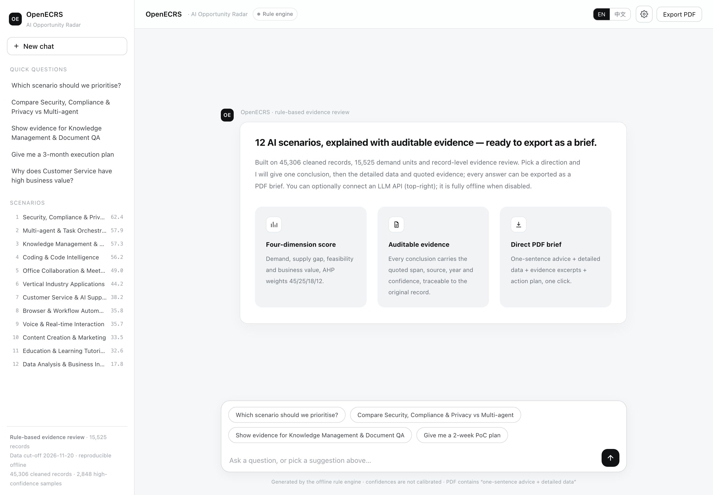

# OpenECRS

**Open Evidence-Centric Recommendation System** — an evidence-driven agent that turns public AI-tooling signals into auditable, prioritised product opportunities.

English · **[中文版](README.zh-CN.md)**



OpenECRS reads a pre-built evidence base of 12 AI application scenarios, scores each one on demand, supply gap, feasibility and business value, and answers questions in a clean chat UI. Every answer starts with a **one-sentence recommendation**, followed by **detailed data**, quoted evidence spans, and an action plan — exportable as a **PDF brief** in one click. An OpenAI-compatible LLM API can optionally rewrite the wording; the numbers and evidence always stay offline and auditable.

## Features

- **Bilingual UI** — switch between English and 中文 from the top bar; English is the default.
- **Evidence, not vibes** — every conclusion carries the quoted span, source, year and confidence, traceable to the original record.
- **One-sentence advice → detailed data** — ranking, scenario scorecard, comparison table, evidence excerpts and action plan are generated deterministically.
- **PDF brief export** — an A4 report (`docs/examples/OpenECRS_brief_en.pdf`) with advice, data, evidence, actions and scope/limitations. Rendered locally by Chrome/Edge/Chromium — no network needed.
- **Optional LLM API** — any OpenAI-compatible endpoint (DeepSeek / OpenAI / Moonshot / DashScope compatible mode / local Ollama). The LLM only rewrites the advice and explanation; if the call fails it falls back to the rule engine automatically.
- **Programmatic HTTP API** — `/api/chat`, `/api/pdf`, `/api/settings`, `/api/test`, `/api/health`.
- **Fully offline by default** — no API key, no telemetry, no external CDN; only Python standard library at runtime.

## Quick start

```bash
# Python 3.11+ (verified on 3.14 / macOS, Linux and Windows should work too)
pip install -r requirements.txt        # pandas is only needed to rebuild data.json

python code/agent_app.py --open        # -> http://127.0.0.1:8765
```

macOS users can also double-click **`openecrs.command`** to launch and open the browser.

Useful flags:

```bash
python code/agent_app.py --port 9000 --open   # different port
python code/agent_app.py --rebuild            # rebuild outputs/agent_ui/data.json from outputs/tables/
```

## Language switch

- UI: top-right **EN / 中文** toggle. The choice is persisted in `localStorage`; the default is English.
- Docs: this file is English; the Chinese version is [README.zh-CN.md](README.zh-CN.md).
- Answers and PDFs are produced in the language of the active UI (`lang=en|zh` on the API).

## Connect an LLM API (optional)

Open the gear icon in the top bar, fill **Base URL / Model / API Key**, click **Test connection**, enable the switch and save. The UI indicates the active engine (`Rule engine` or `LLM · <model>`), and the PDF footer records whether the LLM rewrote the advice.

| Provider | Base URL | Model example |
|---|---|---|
| DeepSeek | `https://api.deepseek.com/v1` | `deepseek-chat` |
| OpenAI | `https://api.openai.com/v1` | `gpt-4o-mini` |
| Moonshot | `https://api.moonshot.cn/v1` | `moonshot-v1-8k` |
| DashScope compatible mode | `https://dashscope.aliyuncs.com/compatible-mode/v1` | `qwen-plus` |
| Local Ollama | `http://127.0.0.1:11434/v1` | local model name, any key |

The key is stored locally in `outputs/agent_ui/settings.json` (mode `0600`) and is only sent to the endpoint you configure. `DEEPSEEK_API_KEY` / `OPENAI_API_KEY` / `LLM_API_KEY` (and `LLM_BASE_URL` / `LLM_MODEL`) are also supported. On timeout / invalid key / malformed output the answer falls back to the rule engine and says so.

## HTTP API

```bash
curl -s http://127.0.0.1:8765/api/chat -H 'Content-Type: application/json' \
  -d '{"session":"demo","message":"Which scenario should we prioritise?","lang":"en"}'

curl -s -X POST http://127.0.0.1:8765/api/pdf -H 'Content-Type: application/json' \
  -d '{"session":"demo","lang":"en"}' -o OpenECRS_brief.pdf
```

| Endpoint | Description |
|---|---|
| `POST /api/chat` | `{session, message, lang}` → structured answer (advice, reply, metrics, ranking, comparison, evidence, actions, risks, chips, engine) |
| `POST /api/pdf` | `{session, lang}` → `application/pdf` brief; JSON fallback if no local browser |
| `GET /api/settings` / `POST /api/settings` | masked LLM settings (key never returned) / save settings |
| `POST /api/test` | test the configured LLM endpoint |
| `GET /api/health` | service, data and PDF backend status |
| `GET /api/data` | compact dataset used by the UI |

## Evidence base

Snapshot date **2026-11-20**:

- 52,007 raw records → 45,306 cleaned records from Hacker News, GitHub, arXiv, Stack Overflow and Product Hunt.
- 19,621 demand/supply units → 15,525 demand units → 2,848 high-confidence scenario samples (18.34%).
- 12 AI application scenarios scored with AHP weights: demand 45% + supply gap 25% + feasibility 18% + business value 12% (CR = 0.0002).
- 15,525 record-level evidence reviews; 162 pass the four-gate opportunity check; 72 evidence quotes are bundled in `outputs/agent_ui/data.json`.

Top five by opportunity score: Security, Compliance & Privacy **62.41**; Multi-agent & Task Orchestration **57.86**; Knowledge Management & Document QA **57.28**; Coding & Code Intelligence **56.20**; Office Collaboration & Meeting Efficiency **48.98**.

The evidence base is produced by a separate analysis pipeline (collection, cleaning, weak supervision, scoring, evidence review). This repository ships only the **agent runtime** plus the tables needed to rebuild `data.json`; it does not include the raw crawl or the fine-tuned LoRA adapter.

## Repository layout

```
OpenECRS/
├─ code/
│  ├─ agent_app.py        # local server: static UI + /api/chat + /api/pdf + settings/test
│  ├─ agent_engine.py     # deterministic bilingual reasoning (ranking / scenario / compare / evidence / risk / action)
│  ├─ scenario_names.py   # shared English display names and route names
│  ├─ agent_llm.py        # optional OpenAI-compatible LLM bridge with automatic fallback
│  ├─ agent_pdf.py        # A4 brief HTML template + local Chromium PDF rendering
│  ├─ agent_ui.html       # single-file bilingual chat UI (no build step, no CDN)
│  ├─ agent_ui_data.py    # rebuild outputs/agent_ui/data.json from outputs/tables/
│  ├─ test_agent_ui.py    # UI / reasoning / PDF / HTTP tests (incl. English mode)
│  └─ test_agent_llm.py   # LLM bridge tests against a local mock endpoint
├─ outputs/
│  ├─ agent_ui/data.json  # bundled dataset: 12 scenarios + 72 evidence quotes
│  └─ tables/             # reconciliation tables (scores, supply, evidence reviews, quality card)
├─ docs/
│  ├─ screenshots/        # bilingual UI screenshots
│  └─ examples/           # sample English / Chinese PDF briefs
├─ openecrs.command       # macOS one-click launcher
├─ requirements.txt
├─ requirements-lora.txt  # dependencies for the (not bundled) LoRA fine-tuning pipeline
└─ README.md / README.zh-CN.md
```

## Tests

```bash
cd code
python -m unittest test_agent_ui test_agent_llm -v   # 31 tests
```

Covers both languages, ranking/scenario/compare/follow-up logic, PDF generation (skipped when no local Chromium is available), the HTTP layer and the LLM bridge with a local mock endpoint.

## Scope and limitations

- Scenario labels come from weak supervision (dictionary + TF-IDF/Logistic Regression expansion), not full human annotation.
- Source bias: Hacker News and GitHub dominate; shares are not true market shares.
- Supply maturity is proxied by repositories, stars, papers and Show HN; willingness-to-pay is a text signal, not actual payment.
- Rule confidences are **not calibrated** (no human gold labels yet); treat them as leads. The optional LLM only rewrites wording — it never changes numbers, ranking or evidence.
- Public data remains subject to the terms and copyright of the original platforms and authors.

## License and attribution

The code in this repository is released for research and evaluation use. Third-party data snippets are quoted for evidence traceability and remain the property of their original authors. See `docs/examples/` for sample briefs.
