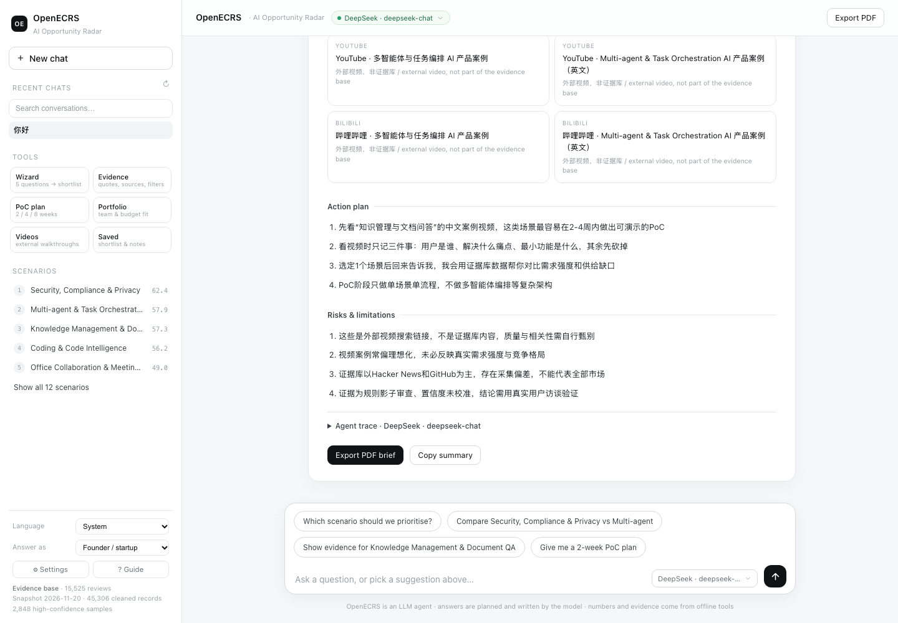
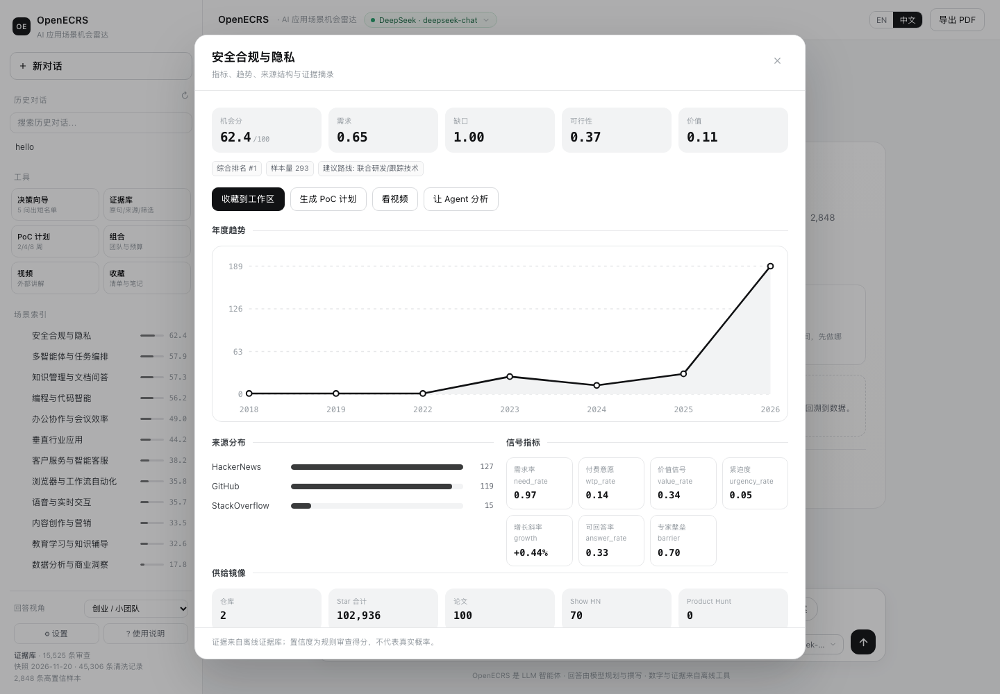
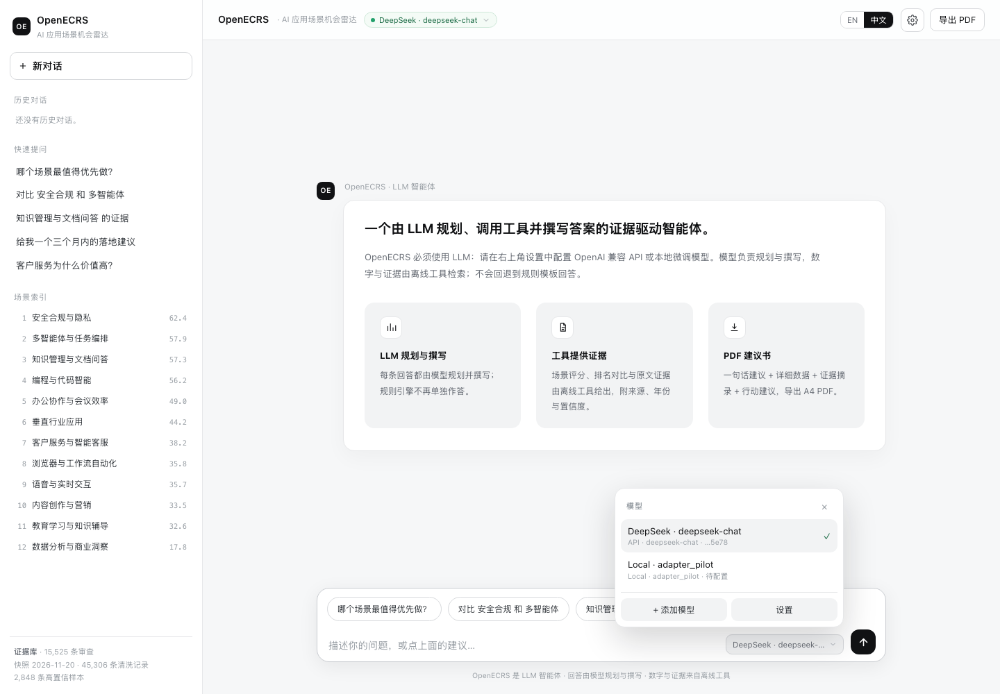

# OpenECRS

**Open Evidence-Centric Recommendation System** — an LLM agent that turns public AI-tooling signals into auditable, prioritised product opportunities.

English · **[中文版](README.zh-CN.md)**



OpenECRS is a **complete agent system**: the LLM is mandatory. The model plans every answer, calls deterministic tools over a pre-built evidence base of 12 AI application scenarios, and writes a **one-sentence recommendation + detailed data + evidence quotes + action plan**, exportable as a PDF brief. Numbers and evidence always come from the tools, never from the model — and if no LLM is configured, the agent refuses to chat.

## Highlights

- **LLM required** — no rule-template answers. API (OpenAI-compatible) or a local fine-tuned Qwen2.5-3B + LoRA adapter.
- **Real agent loop** — `plan → tools → answer`, two model calls per turn; the UI shows an **Agent trace** (intent, tool calls, model latency).
- **Grounded tools** — ranking, scenario metrics, comparisons, evidence search; every claim is traceable to a quoted span.
- **Natural small talk** — greetings get a short, friendly product-guide reply with example questions (no forced scenario pitch, no internal jargon); data questions still go through grounded tools.
- **Videos in chat** — ask “recommend videos” and the agent returns YouTube/Bilibili search cards per scenario (explicitly external, not evidence).
- **Multilingual** — English, 中文, 日本語 and Español; the interface follows your system language by default and switches from the sidebar selector. Chat answers follow the selected language.
- **PDF brief** — one-sentence advice, detailed data, evidence excerpts, action plan, scope & limitations; rendered locally.
- **Programmatic API** — `/api/chat`, `/api/pdf`, `/api/settings`, `/api/test`, `/api/health`.
- **Persistent conversations** — chats are saved to `outputs/agent_ui/sessions.json`, listed under **Recent chats**, and restored after a page reload or a server restart.

## What you can do

| Tool | What it gives you |
|---|---|
| **Decision wizard** | 5 constraints (role, goal, team, budget, horizon, risk) → a 3-scenario shortlist with deterministic scores, reasons and watch-outs; optional LLM narrative. |
| **Evidence explorer** | Filter the 72 quoted spans by scenario, source, year, confidence and positive/negative evidence; read the original span and open the source. |
| **PoC plan** | 2 / 4 / 8-week milestone plan with deliverables, exit criteria, roles, success metrics, data/compliance checklist and heuristic effort/cost. |
| **Portfolio** | Given a team, timeline and budget, what to build, what to validate, what to drop. |
| **Scenario deep-dive** | Opportunity metrics, yearly trend, source mix, supply signals (repos/stars/papers/Show HN) and evidence excerpts. |
| **Saved workspace** | Pin scenarios and notes, then ask the agent to compare the saved shortlist. |
| **Videos** | External YouTube/Bilibili search links per scenario (clearly marked as external, not evidence). |

Answers and panels are bilingual; estimates are labelled **heuristic** and never presented as market facts.




## Architecture

```
planner prompt ──► LLM call #1 ──► strict JSON plan (intent, scenarios, tools)
                                        │
                              deterministic tools (catalog/ranking/scenario/compare/evidence/search)
                                        │
responder prompt ──► LLM call #2 ──► advice + reply + actions + risks
                                        │
                     runtime attaches metrics/ranking/evidence → chat card + PDF
```

The agent behaviour is defined in **[skills/openecrs_agent.md](skills/openecrs_agent.md)** and rendered into the planner/responder prompts by `code/agent_prompts.py`. The LLM only writes wording; the runtime owns data fidelity.

## Quick start

```bash
# Python 3.11+ (verified on 3.14 / macOS)
pip install -r requirements.txt        # pandas is only needed to rebuild data.json

python code/agent_app.py --open        # -> http://127.0.0.1:8765
```

macOS users can double-click **`openecrs.command`**.

On first launch the UI asks for an LLM. Open **Settings** and pick one of:

### API backend (OpenAI-compatible)

| Provider | Base URL | Model example |
|---|---|---|
| DeepSeek | `https://api.deepseek.com/v1` | `deepseek-chat` |
| OpenAI | `https://api.openai.com/v1` | `gpt-4o-mini` |
| Moonshot | `https://api.moonshot.cn/v1` | `moonshot-v1-8k` |
| DashScope compatible mode | `https://dashscope.aliyuncs.com/compatible-mode/v1` | `qwen-plus` |
| Local Ollama | `http://127.0.0.1:11434/v1` | local model name, any key |

Paste the key, click **Test connection**, then **Save**. Keys live in `outputs/agent_ui/settings.json` (0600) and are only sent to the endpoint you configure; `DEEPSEEK_API_KEY` / `OPENAI_API_KEY` / `LLM_API_KEY` and `LLM_BASE_URL` / `LLM_MODEL` are supported too.

### Model switcher

The chip in the top bar shows the active model profile and opens a one-click switcher.
It lists every saved profile (API keys and local adapters), marks the current one, and offers:

- **+ Add model** — save a new API or local profile (each keeps its own key/paths).
- **Settings** — edit or delete the active profile.

Switching applies immediately to the next answer; profiles are stored in `outputs/agent_ui/settings.json` (keys masked in the API).
If the selected profile is not ready, the UI shows an onboarding banner instead of silently falling back.



### Local fine-tuned backend

```bash
pip install -r requirements-lora.txt
# put Qwen2.5-3B-Instruct weights into models/Qwen2.5-3B-Instruct
# the bundled pilot adapter lives in outputs/lora/adapter_pilot
```

In Settings → **Local fine-tuned**, set the base model path and adapter path, click Test, save. CPU inference is slow; GPU recommended. The pilot adapter was trained on 160 pseudo-labelled samples / 24 steps and exists to validate the training and inference chain, not to claim accuracy.

## Agent Skill

The full skill (role, data contract, tool definitions, workflow, output rules, guardrails) is published at
[`skills/openecrs_agent.md`](skills/openecrs_agent.md). It is the same text used by `agent_prompts.py`, so hosted and local models behave consistently.

## HTTP API

```bash
curl -s http://127.0.0.1:8765/api/chat -H 'Content-Type: application/json' \
  -d '{"session":"demo","message":"Which scenario should we prioritise?","lang":"en"}'

curl -s -X POST http://127.0.0.1:8765/api/pdf -H 'Content-Type: application/json' \
  -d '{"session":"demo","lang":"en"}' -o OpenECRS_brief.pdf
```

| Endpoint | Description |
|---|---|
| `POST /api/chat` | `{session, message, lang}` → agent answer (advice, reply, metrics, ranking, comparison, evidence, actions, risks, engine, trace) |
| `POST /api/pdf` | `{session, lang}` → `application/pdf` brief |
| `GET/POST /api/settings` | read (key masked) / save LLM backend settings |
| `POST /api/test` | test the selected backend |
| `GET /api/health` | service, LLM readiness, data and PDF backend status |
| `GET /api/data` | compact dataset used by the UI |

When no LLM is configured, `/api/chat` returns **HTTP 428** with `{"code": "llm_required", "hint": ...}` — the agent never falls back to templates.

## Evidence base

Snapshot **2026-11-20**: 52,007 raw records → 45,306 cleaned records (Hacker News, GitHub, arXiv, Stack Overflow, Product Hunt) → 19,621 demand/supply units → 15,525 demand units → 2,848 high-confidence scenario samples (18.34%). 15,525 evidence reviews, 162 four-gate opportunities, 72 quotes bundled in `outputs/agent_ui/data.json`.

Top five: Security, Compliance & Privacy **62.41**; Multi-agent & Task Orchestration **57.86**; Knowledge Management & Document QA **57.28**; Coding & Code Intelligence **56.20**; Office Collaboration & Meeting Efficiency **48.98**.

The analysis pipeline that produced this evidence base (collection, cleaning, weak supervision, scoring, evidence review) is not part of this repository; only the agent runtime and the tables needed to rebuild `data.json` are included.

## Repository layout

```
OpenECRS/
├─ code/
│  ├─ agent_app.py        # HTTP server + static UI + API endpoints
│  ├─ agent_core.py       # agent loop: plan → tools → answer, session memory, trace
│  ├─ agent_prompts.py    # Agent Skill → planner / responder prompts (bilingual)
│  ├─ agent_tools.py      # grounded scenario data, ranking, comparison, evidence search
│  ├─ agent_settings.py   # API / local backend settings, legacy migration, readiness
│  ├─ agent_providers.py  # provider resolution + connection test
│  ├─ agent_llm.py        # OpenAI-compatible HTTP client
│  ├─ agent_local.py      # local Qwen2.5 + LoRA provider (optional)
│  ├─ agent_pdf.py        # A4 brief template + local Chromium PDF rendering
│  ├─ agent_ui.html       # single-file bilingual UI (no build step, no CDN)
│  ├─ agent_ui_data.py    # rebuild outputs/agent_ui/data.json
│  └─ test_*.py           # tools / core / HTTP tests (18)
├─ skills/openecrs_agent.md
├─ outputs/agent_ui/data.json
├─ outputs/tables/        # reconciliation tables (scores, evidence reviews, quality card)
├─ docs/screenshots, docs/examples
├─ openecrs.command, requirements.txt, requirements-lora.txt
└─ README.md / README.zh-CN.md
```

## Languages

The bottom profile card opens a compact, borderless popover with **Answer settings**, **Settings**, **Guide** and **About data**. Language and answer role live in **Settings → Preferences** (Answer settings jumps straight there), keeping the model form clean. The language selector offers **System** (default), English, 中文, 日本語 and Español. “System” resolves `navigator.language` (zh/ja/es, otherwise English); the choice is remembered locally. The selected language is sent with every chat/feature request, so answers, prompts and labels follow it. PDF templates currently fall back to English for ja/es.

## Roles

The **Answer as** selector in the sidebar changes the planning and writing perspective:
`founder` (feasibility, MVP, 2–4-week validation), `enterprise` (compliance, org coordination, decision memo),
`investor` (market, competition, evidence strength, downside) and `PM` (user pain, roadmap, metrics, trade-offs).
The role is sent with every chat request and reflected in the answer.

## Tests

```bash
cd code
python -m unittest test_agent_tools test_agent_core test_agent_http test_agent_features test_agent_insights -v   # 88 tests
```

Covers grounded tools, planner/responder validation with a fake provider, the LLM-required guard, HTTP settings/test/chat endpoints against a mock OpenAI endpoint, and PDF export when a local browser is available.

## Scope and limitations

- Scenario labels come from weak supervision, not full human annotation.
- Source bias: Hacker News and GitHub dominate; shares are not true market shares.
- Supply maturity is proxied by repos/stars/papers/Show HN; willingness-to-pay is a text signal.
- Rule confidences are **not calibrated** (no human gold labels); the agent states this in every brief.
- The LLM may phrase recommendations differently between runs; numbers and evidence are deterministic.
- Public data remains subject to the terms and copyright of the original platforms and authors.

## License and attribution

Code in this repository is released for research and evaluation use. Quoted third-party data snippets remain the property of their original authors.
## Desktop build note

This local copy also ships the pilot LoRA adapter under `outputs/lora/adapter_pilot/` for the local fine-tuned backend (not included in the GitHub repository; the Qwen2.5-3B-Instruct base weights are still required).
