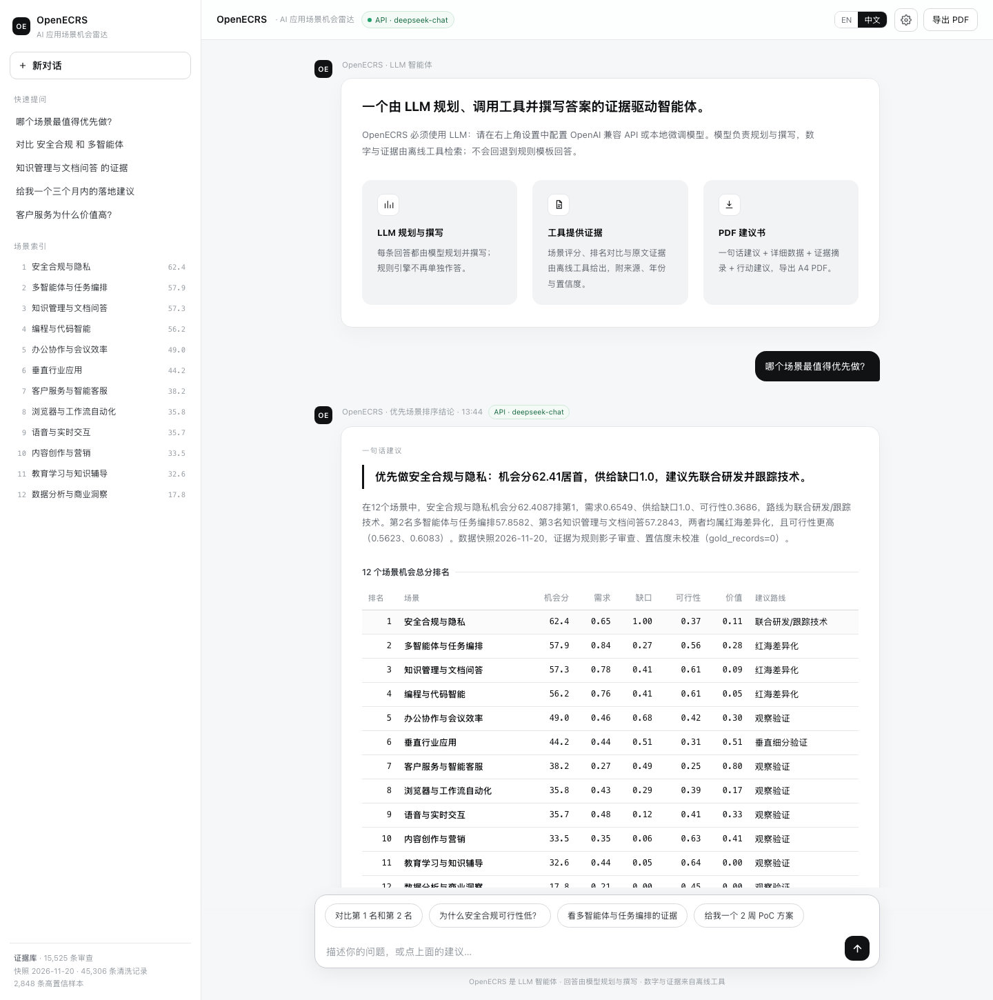

# OpenECRS

**Open Evidence-Centric Recommendation System（证据驱动机会推荐智能体）** —— 用 LLM 把公开的 AI 工具信号变成可核查、可排序的产品机会。

**[English](README.md)** · 中文版



OpenECRS 是一个**完整的 Agent 系统**：**必须使用 LLM**。模型负责规划每一次回答，调用离线工具检索证据库，再撰写「一句话建议 + 详细数据 + 原文证据 + 行动建议」，可一键导出 PDF 建议书。数字与证据永远来自工具，而不是模型；如果未配置 LLM，智能体拒绝对话。

## 核心特性

- **必须有 LLM**：不再使用规则模板作答。支持 OpenAI 兼容 API，或本地 Qwen2.5-3B + LoRA 适配器。
- **真正的 Agent 循环**：`规划 → 工具 → 作答`，每轮两次模型调用；界面展示 **Agent 过程**（意图、工具调用、模型耗时）。
- **工具提供证据**：排名、场景指标、对比、证据检索；每条结论都能回溯到原文 span。
- **中英双语**：默认英文，可切换中文；README、回答、PDF 都跟随当前语言。
- **PDF 建议书**：一句话建议、详细数据、证据摘录、行动建议、口径局限，本地渲染。
- **程序化 API**：`/api/chat`、`/api/pdf`、`/api/settings`、`/api/test`、`/api/health`。

## 架构

```
规划 prompt ──► LLM 第 1 次 ──► 严格 JSON 计划（意图、场景、工具）
                                     │
                        离线工具（catalog / ranking / scenario / compare / evidence / search）
                                     │
作答 prompt ──► LLM 第 2 次 ──► 一句话建议 + 说明 + 行动 + 风险
                                     │
                 运行时附加指标/排名/证据 → 对话卡片 + PDF
```

Agent 行为定义在 **[skills/openecrs_agent.md](skills/openecrs_agent.md)**，由 `code/agent_prompts.py` 渲染成规划/作答 prompt。模型只负责措辞，数据真实性由运行时保证。

## 快速开始

```bash
# Python 3.11+（已在 3.14 / macOS 验证）
pip install -r requirements.txt        # pandas 只在重建 data.json 时需要

python code/agent_app.py --open        # -> http://127.0.0.1:8765
```

macOS 也可以直接双击 **`openecrs.command`**。

首次启动界面会提示需要 LLM。打开 **设置**，二选一：

### API 模式（OpenAI 兼容）

| 服务 | Base URL | 模型示例 |
|---|---|---|
| DeepSeek | `https://api.deepseek.com/v1` | `deepseek-chat` |
| OpenAI | `https://api.openai.com/v1` | `gpt-4o-mini` |
| Moonshot | `https://api.moonshot.cn/v1` | `moonshot-v1-8k` |
| 通义 DashScope 兼容模式 | `https://dashscope.aliyuncs.com/compatible-mode/v1` | `qwen-plus` |
| 本地 Ollama | `http://127.0.0.1:11434/v1` | 本地模型名，Key 随意 |

填 Key → 「测试连接」→「保存」。Key 只保存在本机 `outputs/agent_ui/settings.json`（0600）；也支持 `DEEPSEEK_API_KEY` / `OPENAI_API_KEY` / `LLM_API_KEY` 以及 `LLM_BASE_URL` / `LLM_MODEL`。

### 本地微调模式

```bash
pip install -r requirements-lora.txt
# 把 Qwen2.5-3B-Instruct 权重放到 models/Qwen2.5-3B-Instruct
# 包内试训适配器在 outputs/lora/adapter_pilot
```

设置 → **本地微调**：填写基座模型路径与适配器路径 → 测试 → 保存。CPU 推理较慢，推荐 GPU。该适配器由 160 条伪标签、24 步试训得到，仅用于验证训练/推理链路，不代表准确率。

## Agent Skill

完整技能定义（角色、数据口径、工具、工作流、输出规则、护栏）见
[`skills/openecrs_agent.md`](skills/openecrs_agent.md)，与 `agent_prompts.py` 使用同一份技能文本，保证 API 与本地模型行为一致。

## 程序化调用

```bash
curl -s http://127.0.0.1:8765/api/chat -H 'Content-Type: application/json' \
  -d '{"session":"demo","message":"哪个场景最值得优先做？","lang":"zh"}'

curl -s -X POST http://127.0.0.1:8765/api/pdf -H 'Content-Type: application/json' \
  -d '{"session":"demo","lang":"zh"}' -o 建议书.pdf
```

| 接口 | 说明 |
|---|---|
| `POST /api/chat` | `{session, message, lang}` → 回答（建议、说明、指标、排名、对比、证据、行动、风险、引擎信息、Agent 过程） |
| `POST /api/pdf` | `{session, lang}` → `application/pdf` 建议书 |
| `GET/POST /api/settings` | 读取（Key 脱敏）/ 保存 LLM 设置 |
| `POST /api/test` | 测试当前后端 |
| `GET /api/health` | 服务、LLM 就绪状态、数据与 PDF 后端 |
| `GET /api/data` | 界面使用的紧凑数据集 |

未配置 LLM 时，`/api/chat` 返回 **HTTP 428** 与 `{"code": "llm_required", "hint": ...}` —— 绝不回退到模板回答。

## 证据库

快照 **2026-11-20**：52,007 条原始记录 → 45,306 条清洗记录（Hacker News、GitHub、arXiv、Stack Overflow、Product Hunt）→ 19,621 个需求/供给单元 → 15,525 条需求单元 → 2,848 条高置信场景样本（18.34%）。15,525 条证据审查、162 条四门机会、`outputs/agent_ui/data.json` 内置 72 条原文证据。

机会总分前五：安全合规与隐私 **62.41**；多智能体与任务编排 **57.86**；知识管理与文档问答 **57.28**；编程与代码智能 **56.20**；办公协作与会议效率 **48.98**。

产出证据库的分析流水线（采集、清洗、弱监督、评分、证据审查）不在本仓库内；本仓库只包含 Agent 运行时与重建 `data.json` 所需的对账表。

## 目录结构

```
OpenECRS/
├─ code/
│  ├─ agent_app.py        # HTTP 服务 + 静态界面 + API
│  ├─ agent_core.py       # Agent 循环：规划 → 工具 → 作答、会话记忆、过程记录
│  ├─ agent_prompts.py    # Agent Skill → 规划/作答 prompt（中英）
│  ├─ agent_tools.py      # 场景数据、排名、对比、证据检索等离线工具
│  ├─ agent_settings.py   # API / 本地后端设置、旧配置迁移、就绪检查
│  ├─ agent_providers.py  # 后端解析与连通性测试
│  ├─ agent_llm.py        # OpenAI 兼容 HTTP 客户端
│  ├─ agent_local.py      # 本地 Qwen2.5 + LoRA 后端（可选）
│  ├─ agent_pdf.py        # A4 建议书模板与本地 Chromium 渲染
│  ├─ agent_ui.html       # 单文件双语界面（无构建、无 CDN）
│  ├─ agent_ui_data.py    # 重建 outputs/agent_ui/data.json
│  └─ test_*.py           # 工具 / 核心 / HTTP 测试（18 项）
├─ skills/openecrs_agent.md
├─ outputs/agent_ui/data.json
├─ outputs/tables/        # 对账表（评分、证据审查、质量卡）
├─ docs/screenshots、docs/examples
├─ openecrs.command、requirements.txt、requirements-lora.txt
└─ README.md / README.zh-CN.md
```

## 自检

```bash
cd code
python -m unittest test_agent_tools test_agent_core test_agent_http -v   # 18 项
```

覆盖离线工具、规划/作答校验（假 provider）、未配置 LLM 的拒绝路径、HTTP 设置/测试/对话（本地 mock OpenAI 端点）以及有浏览器时的 PDF 导出。

## 口径与局限

- 场景标签来自弱监督，不是人工全量标注。
- 来源偏差：Hacker News / GitHub 占比较高，不能当作真实市场占比。
- 供给成熟度用仓库/Star/论文/Show HN 近似；付费意愿来自文本信号。
- 规则置信度**未经人工校准**（无金标），智能体会在每份建议书中注明。
- 同一问题在不同轮次措辞可能不同；数字与证据是确定性的。
- 公开数据版权归各平台与作者所有。

## 许可与署名

仓库代码供研究与评估使用；引用的第三方数据片段仅用于证据溯源，版权归原作者所有。
